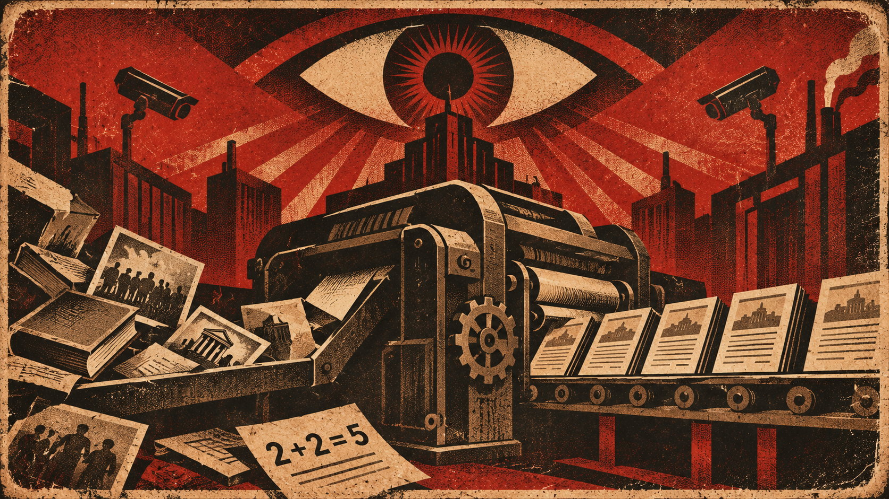
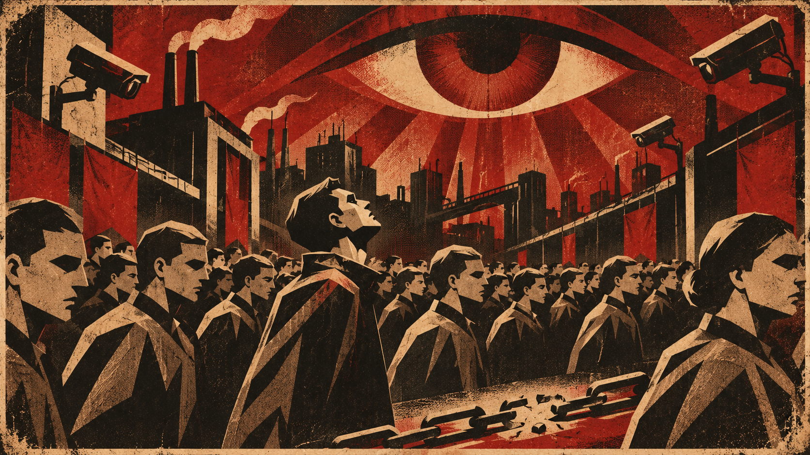
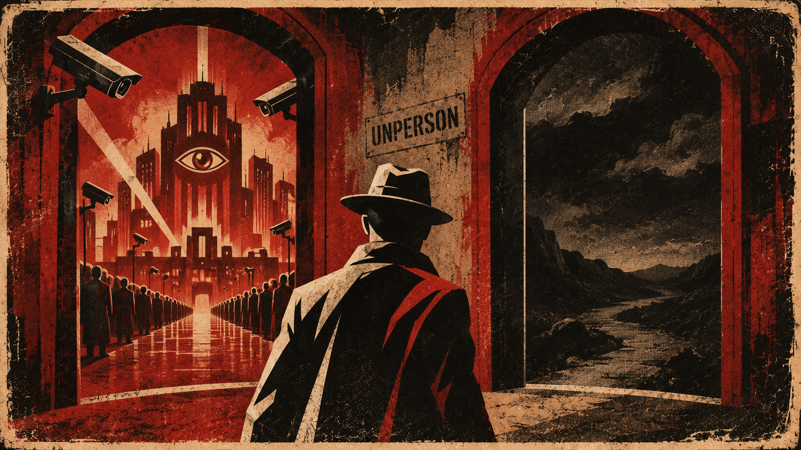

## Parte 1

### Capítulo 1

O primeiro capítulo demonstra ao leitor grande parte do que é o partido, descrevendo as estruturas físicas, slogans, instituições e a forma de monitoramento e controle da população.

> "Guerra é paz
> Liberdade é escravidão
> Ignorância é força"

Demonstra também o pão e circo da população: "Ontem à noite [...] Só filme de guerra".

### Capítulo 2

No segundo capítulo é demonstrado um controle sobre os mais jovens, destruindo a esperança da geração futura se livrar do controle do partido, e demonstra o plano em ação para a destruição do raciocínio lógico: o "Socing", que remetia à novafala, que diminuía o vocabulário da língua, o duplipensamento e a mutabilidade do passado, que alterava fatos históricos de acordo com a vontade do partido.

### Capítulo 3

No capítulo 3 é demonstrado as políticas de guerra e o militarismo, assim também como um pouco da mutabilidade do passado. É revelado também que Socing significa socialismo inglês em "velha fala".

### Capítulo 4

Neste capítulo é demonstrado o funcionamento de um departamento do ministério da verdade e como funciona a mudança da história por parte do partido, assim como a destruição de qualquer fato e pessoa histórica que possa ser ou inspirar pessoas a serem contra o G.I (grande irmão).

### Capítulo 5

No capítulo 5 é demonstrado como as pessoas imersas no controle do partido agem. Syme e Parsons são a representação da frase de Matrix:

> "A maioria destas pessoas não estão preparadas para despertar. E muitos deles estão tão inertes, tão desesperados dependendo do sistema, que vão lutar para protegê-lo."

### Capítulo 6

Este capítulo demonstra como o partido controla um pilar fundamental da sociedade, a família. Por meio do monopólio da decisão de aceitar ou não um casamento e filtrar por meio dos casais com menor afetos sexuais e amorosos, proibindo a separação, a fórmula para o rompimento dos elos familiar está pronta.

### Capítulo 7

É demonstrada a grande força da massa da população, que representa cerca de 85% da população do continente. Porém estes ainda estão inertes e dependentes do sistema e para acabar com a matrix é preciso rebelar-se contra ele.

> "Enquanto eles não se conscientizarem, não serão rebeldes autênticos e, enquanto não se rebelarem, não têm como se conscientizar."

Apesar da ditadura da liberdade ter libertado os proletas de um regime de escravidão capitalista, os mesmos agora eram comparados a animais. Entre eles eram infiltrados representantes do sistema para eliminar os perigosos e controlar os pacíficos. Usados somente para o trabalho pesado e para manutenção deste trabalho por meio da procriação. "Animais e proletas são livres."

Tal liberdade se olhava para o apaziguamento da classe de uma força tremenda, porém pensamento alienado.

Caso algum deles sonhasse em instigar o pensamento de libertade e liberdade, o mesmo seria abatido como se fazem com gado.

O desejo do partido é que todos se tornassem em parte desta classe, a parte alienada sonhando com pensamentos iguais como se todos representassem uma

\* Infiltrados = Polícia das ideias. Instituição para a execução de pensadores contra o partido.

Demonstra também co-fundadores sendo eliminados pelo partido, seja para controle único do G.I, seja por se rebelarem: Jones, Rutherford, Aaronson.

> "O partido haveria de anunciar que dois mais dois são cinco, e você seria obrigado a acreditar."

O protagonista se liberta da última garra do partido, o coletivismo. E defende a liberdade mesmo que todos os demais defendam a escravidão.

> "Liberdade é a liberdade de dizer que dois mais dois são quatro. Se isso for admitido, tudo demais é decorrência."

### Capítulo 8

O oitavo capítulo finaliza o primeiro arco dos três existentes no livro. Se pode evidenciar a visita às favelas, ambiente comum dos proletas, que apesar de não ser agradável verdadeiramente ainda assim propicia o segundo item mais importante para a vida. O primeiro é a própria essência da vida e o segundo a que me refiro nesse resumo é a liberdade, pois quem seríamos nós sem ela.

Parando para refletir, um escravo, ao prestar o serviço forçado para seu senhorio, vive? Poderíamos dizer que sim, porém vive em função de alguém. Como exemplo podemos citar um enfermo vegetando, este também vive? Da mesma forma que o escravo, tecnicamente podemos dizer que sim, porém em essência muitos preferem a morte do que viver de tal maneira, e os que restam somente resistem a tal torturas devido a sonharem com a liberdade da própria vida.

Winston se depara em certos momentos com fragmentos da verdadeira vida, a que utiliza-se realmente de sua própria liberdade, e ao se deparar com a possibilidade de parar de sonhar com a perspectiva de realmente viver a vida por desconfiar de que uma membro do partido o esteja observando e o denunciar para a polícia das ideias, Winston ativa seus sentidos primitivos de sobrevivência e pensa em matá-la, porém volta à racionalidade e sem esperanças volta para casa e como fuga da realidade bebe gim.

## Fim da 1ª parte

O fim da primeira parte foi claramente o momento de pensamento sobre a realidade onde vive e se sentir incomodado com a mesma e entrar em uma busca pela liberdade.

Esses momentos ficam claros à medida em que Winston visita lugares onde não está em observação pelo governo, como os bairros dos proletas.

Serve também para demonstrar ao leitor o quanto o partido pode ser cruel com diversos itens, como a história, alterando os fatos do passado; a família, conciliando casamentos somente para a produção de pessoas a favor do governo por meio da manipulação; e principalmente com a liberdade, a qual sem somos meros animais racionais, por meio do controle das ações dos indivíduos.

Outra a qual pode ser mencionada é a própria riqueza da língua, que pela novafala vem sendo simplificada

## Notas do autor

Isto é algo que escrevi para mim mesmo, como anotações de leitura. O propósito não é o entendimento geral do livro: o texto assume que você já leu 1984 e reflete a minha interpretação na época.
