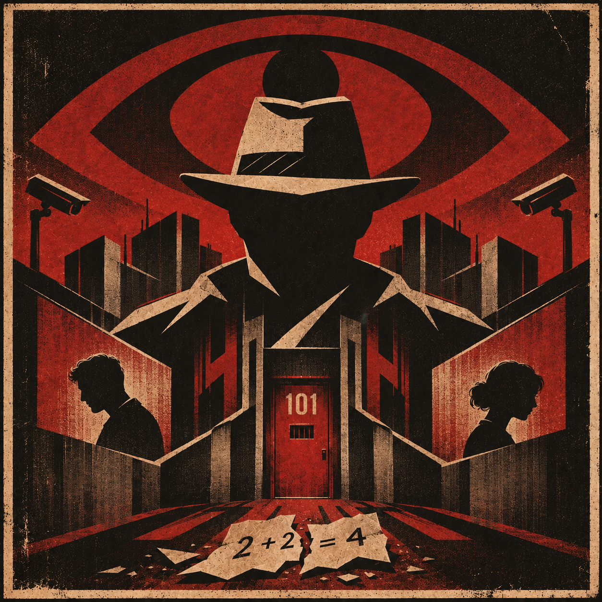

## Parte 2

### Capítulo 1 ao 4

\* Nota: irei escrever sobre os 4 capítulos por possuírem a mesma essência, pelo menos foi o que senti.

Winston encontra a garota até então misteriosa e descobre que a perseguição não era no real plano prendê-lo e sim por "amor". É revelado também seu nome, "Julia".

Winston se sente surpreso com estas descobertas e tenta se encontrar com ela longe das tele-telas.

Os 2 marcam um encontro em um lugar distante, longe dos olhos do partido. Ao se encontrarem, Julia se demonstra uma pessoa que, apesar de odiar o partido, o segue fervorosamente para que não descubram e desconfiem que ela tem um amor pela liberdade e pelo prazer, e Winston junto à Julia transam depois de muito tempo.

\* Este resumo não traz toda a essência dos capítulos por basicamente desenvolverem o romance de Julia e Winston.

### Capítulo 5 ao 10

Os demais capítulos da parte 2 são sobre a descoberta que O'Brien fazia parte da conspiração contra o partido, onde é entregue a Winston e Julia o livro que descreve o funcionamento interno e simbologia do partido. Porém ao final Winston é pego pela polícia das ideias.

## Parte 3

A parte 3 se demonstra a mais assustadora, desumana e desesperançosa. Winston se encontra em uma prisão, em uma cela junto a outros presos que são tratados como animais e agem como tal para não sofrerem com as punições, ao ponto de oferecerem matar sua família composta por 2 filhos de idade inferior a 10 anos e sua esposa.

Privados de comida, água e até noção de tempo, visto que as luzes da cela ficam sempre acesas, os prisioneiros agem como animais em busca dos recursos para sobreviver, ou até mesmo morrer para fuga das torturas feitas pelo Estado.

## Notas do autor

Isto é algo que escrevi para mim mesmo, como anotações de leitura. O propósito não é o entendimento geral do livro: o texto assume que você já leu 1984 e reflete a minha interpretação na época.

Ao passar as anotações do caderno para o blog, corrigi alguns pontos:

- No caderno, o protagonista aparecia como "Orwell" no trecho final da Parte 2 e na Parte 3. Corrigido para Winston; Orwell é o autor do livro.
- O caderno trazia "Capítulo 4-9" na Parte 2. Corrigido para "Capítulo 5 ao 10", já que o bloco anterior termina no capítulo 4 e a Parte 2 tem 10 capítulos.
- A expressão "é pelo pela polícia" do caderno foi lida como "é pego pela polícia".
- O caderno dizia que a sala da prisão era "totalmente escura". No livro, as luzes do Ministério do Amor ficam sempre acesas, e é isso que tira a noção de tempo dos prisioneiros.
