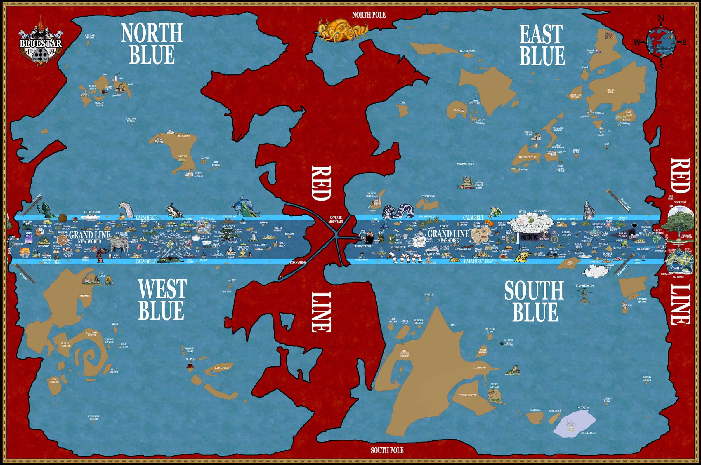
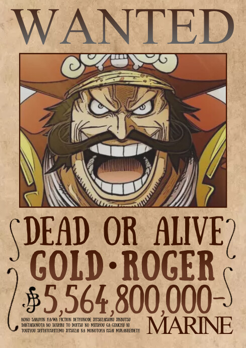

One Piece is a manga and anime that has existed for more than 20 years, with a legion of fans. It was created by Eiichiro Oda.

The story's introduction is simple. It is a world where most of the land is islands and archipelagos, divided into four oceans: East Blue, West Blue, North Blue and South Blue, with the Red Line, a huge strip of land, encircling the globe. With that geography, the most important force is not the army but the Navy, and the main outlaws are pirates.

The greatest pirate of all, Gold D. Roger, was executed by the Marines, and on that day he proclaimed that his treasure, the One Piece, was out there for anyone to find. From that day on, a new era of piracy began.

---

## Notes

<!-- escreva aqui -->
