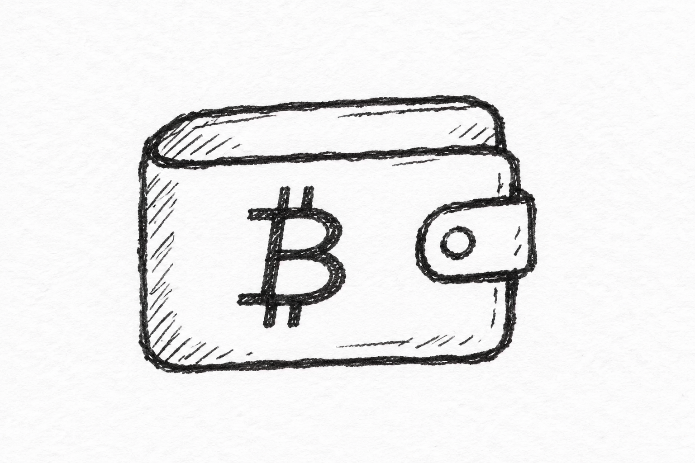
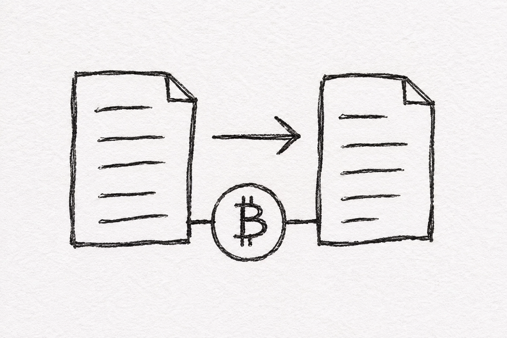
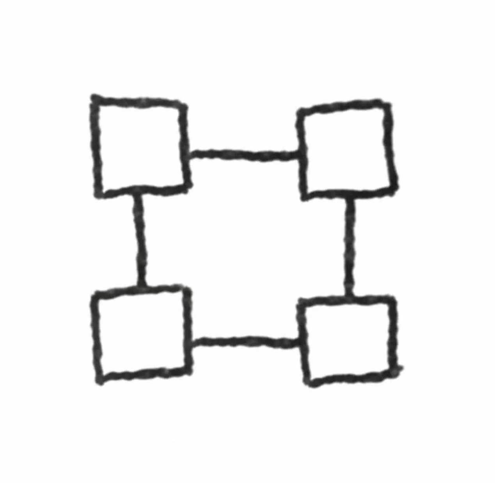
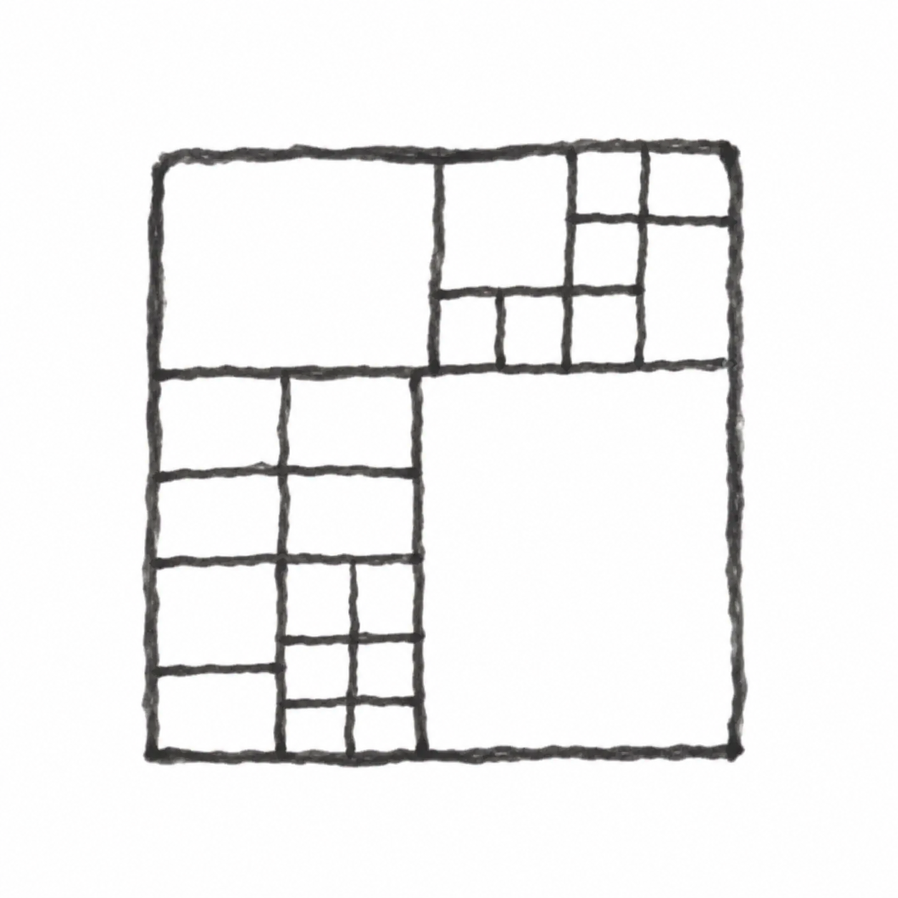
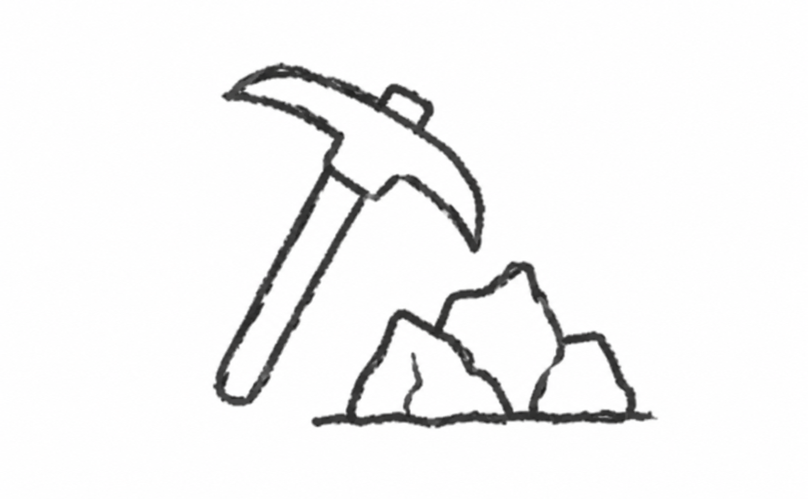
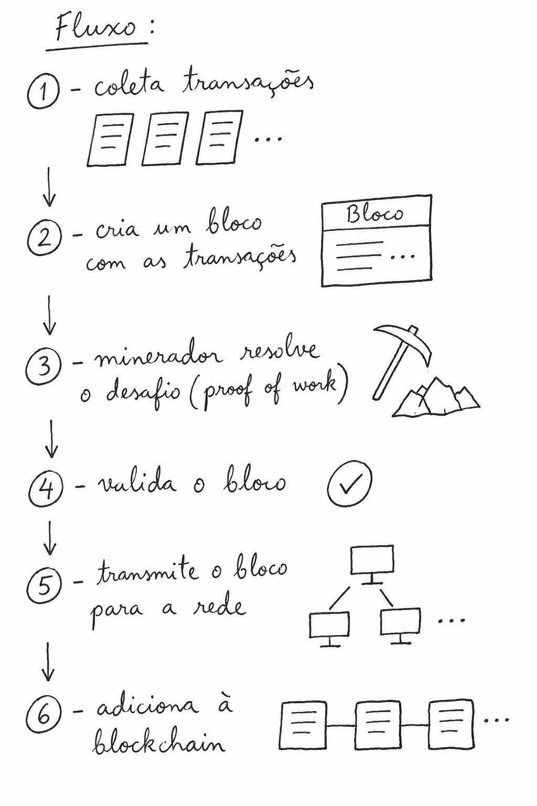
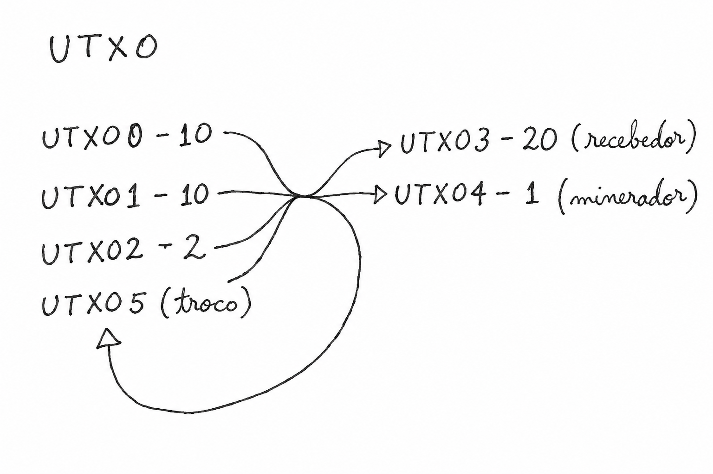
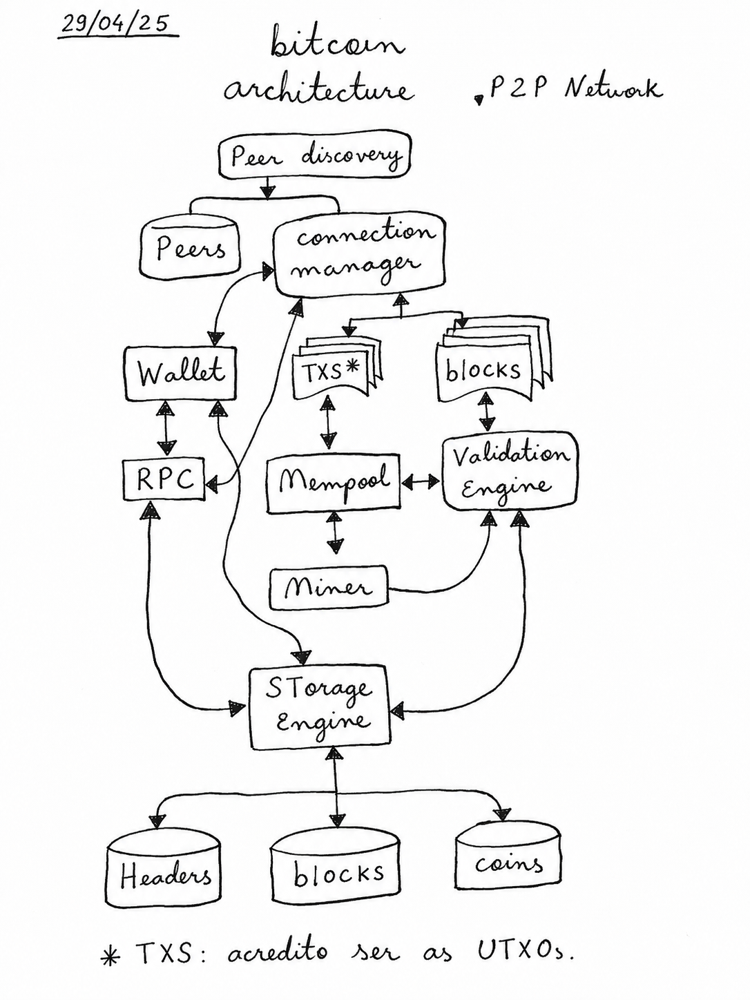

*Livro de Andreas M. Antonopoulos*

## O que é o Bitcoin

Bitcoin consiste de:

- Uma rede peer-to-peer (protocolo Bitcoin)
- Um livro-razão público
- Um conjunto de regras para validação independente de transações e emissão de moeda (regras de consenso)
- Um mecanismo para alcançar o consenso global descentralizado na blockchain

O desenvolvimento de um dinheiro digital antes do Bitcoin está associado à criptografia.

## As três perguntas básicas para criação e aceitação de uma moeda virtual

- Validar que a moeda é autêntica e não falsificada
- Validar que ela só pode ser gasta uma vez (evitar o "double-spend")
- Garantir que ninguém tome posse do dinheiro que é meu

Criptografia digital utilizando assinaturas habilita os usuários a assinar ativos e transações digitalmente.

## Por que o Bitcoin não tem uma estrutura de rede hierárquica?

O Bitcoin possui uma arquitetura peer-to-peer de rede descentralizada, o que provê para os usuários uma autonomia na rede, além de ser uma arquitetura que não possui um ponto único de falha.

Caso possuísse uma arquitetura centralizada, seria fácil:

- A censura por entidades governamentais
- O ataque à rede, por ser um ponto único de falha

Bitcoin é composto de 4 inovações essenciais:

- Protocolo peer-to-peer
- Blockchain
- Consensus rule
- Mecanismo de consenso descentralizado (proof of work)

## Conceitos

- Wallets
- Transactions
- Blockchain
- Block
- Address

###  Wallet

A wallet é responsável por guardar as chaves privadas, que são utilizadas para assinar as transações.

### Address

É como um número de conta bancária e é gerado da seguinte forma:

```text
chave privada → chave pública → address
```

Portanto, uma wallet pode possuir *n* addresses.

###  Transactions

Uma transação é o envio de uma quantia de bitcoin entre duas carteiras.

Fluxo:

1. Criação da transação (wallet alvo)
2. Início da transação com endereço alvo (colocar endereço e valor)
3. Assinatura da transação
4. Envio para a rede
5. Mineração e inclusão no bloco
6. Recebimento na wallet alvo

###  Blockchain

A blockchain é uma estrutura de dados imutável e distribuída que funciona como livro-razão digital, composta por blocos encadeados criptograficamente.

###  Block

Um bloco é um conjunto de transações, junto com a "coinbase transaction" (recompensa do minerador), que é a primeira transação do bloco, hash do bloco anterior e nonce (valor que o minerador pode alterar).

Exemplo de bloco:

```text
Bloco {
  versão
  Hash bloco anterior
  Merkle root*
  Timestamp
  Dificuldade
  Transações [Lista T]
}
```

\* Um hash que resume todas as transações do bloco.

###  Proof of Work

O objetivo do proof of work é gerar um hash menor que o designado pela dificuldade da rede.

O fluxo é o seguinte:



1. Coleta transações da mempool
2. Minerador monta um bloco candidato
3. Calcula hash com nonce
4. Atingiu o hash alvo?
   - **Não:** gera novo nonce
   - **Sim:** propaga bloco → rede valida → adiciona à blockchain

## UTXO — Unspent Transaction Output

O UTXO é a unidade representativa no Bitcoin, onde a carteira não possui uma soma dos valores totais, como em um banco, mas sim a composição de diversos valores de UTXO. Por analogia, o sistema UTXO é como um cofrinho que possui diversas notas e moedas, e quando é necessário comprar algo, se recebe o troco menos o valor da taxa do minerador.

**Exemplo:** vou a um restaurante com uma nota de 20 e a conta deu 15. Eu dou a nota de 20 e recebo 5, menos a gorjeta do garçom.

Vale ressaltar que a taxa é cobrada pelo tamanho da transação, e cada UTXO usada como entrada aumenta esse tamanho, portanto possuir UTXOs pequenas pode ser caro.

**Exemplo:** se eu for pagar a conta de 15 com moedas de 10 e 25 centavos, cada moeda aumentaria a conta do garçom.

A soma dos UTXOs de uma carteira dá o saldo total dela.

O output de uma transação gera um novo UTXO, portanto, por analogia, ao pagar uma conta de 20 com duas notas de 10, é gerada uma nota de 20 proveniente das duas de 10.



O troco volta para minha wallet como um UTXO novo de 1 real.

\* Na prática, a taxa do minerador não vira um UTXO: é a diferença implícita entre entradas e saídas, e o minerador a recolhe na coinbase. O "UTXO 4" do desenho serve só para visualizar a taxa.

## Bitcoin Architecture

*29/04/25*



\* TXS: acredito ser as UTXOs. Revisando: são as transações trafegando pela rede. O conjunto de UTXOs é o banco `coins`.

## Fix notes

- **4 inovações:** a lista só tem 3 itens. A quarta provavelmente é o mecanismo de consenso descentralizado (proof of work).
- **Taxa do minerador:** ela não vira um UTXO. É a diferença implícita entre entradas e saídas, então o UTXO 4 do diagrama não existiria. O minerador recolhe esse valor na coinbase.
- **Taxa por UTXO:** a taxa é cobrada pelo tamanho da transação em vbytes. UTXOs pequenas saem caras porque cada entrada aumenta esse tamanho, não porque cada uma pague uma taxa própria.
- **TXS no diagrama:** o asterisco diz que acredito serem as UTXOs, mas ali são as transações trafegando pela rede. O conjunto de UTXOs é o banco `Coins`.
- **Double-spend:** a nota diz "pode ser feito numa única transação". O sentido é garantir que a moeda só possa ser gasta uma vez.

## Referências

- [Mastering Bitcoin 3rd Edition, Part 2: How Bitcoin Works (deep summary)](https://medium.com/@bitcoinloverhq/mastering-bitcoin-3rd-edition-part-2-how-bitcoin-works-deep-summary-explanations-66e79f88ade5)
- [bitcoinbook/bitcoinbook](https://github.com/bitcoinbook/bitcoinbook), repositório do livro no GitHub
